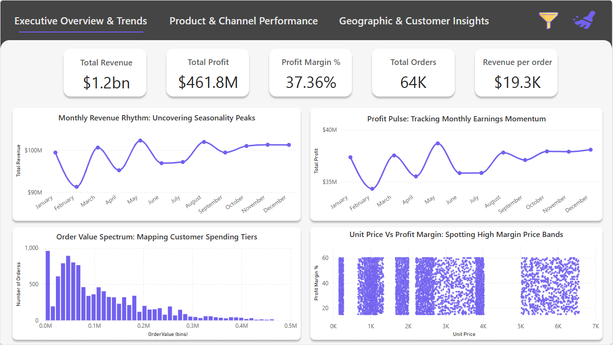

# Retail Sales Analytics

Retail sales data analysis project combining Python (Pandas & Matplotlib), SQL queries, and a Power BI dashboard to evaluate revenue trends, profit margins, and customer segments.



## Features

- Exploratory data analysis (EDA) and data cleaning in Python with Pandas
- SQL queries for aggregating revenue, order volume, and product performance
- Monthly seasonality and profit margin visualizations
- Executive Power BI dashboard summarizing key business metrics

## Tech Stack

- Python (Pandas, NumPy, Matplotlib, Seaborn)
- SQL
- Microsoft Power BI
- Jupyter Notebook

## Getting Started

1. Clone the repository:
```bash
git clone https://github.com/davyd9/retail-sales-analytics-python.git
cd retail-sales-analytics-python
```

2. Install the required Python libraries:
```bash
pip install pandas numpy matplotlib seaborn jupyter
```

3. Explore the SQL scripts, notebooks, and dashboard files in the repository folders.
